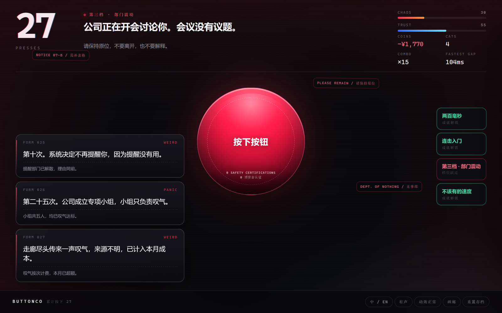
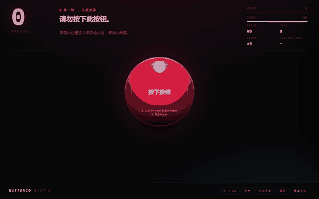
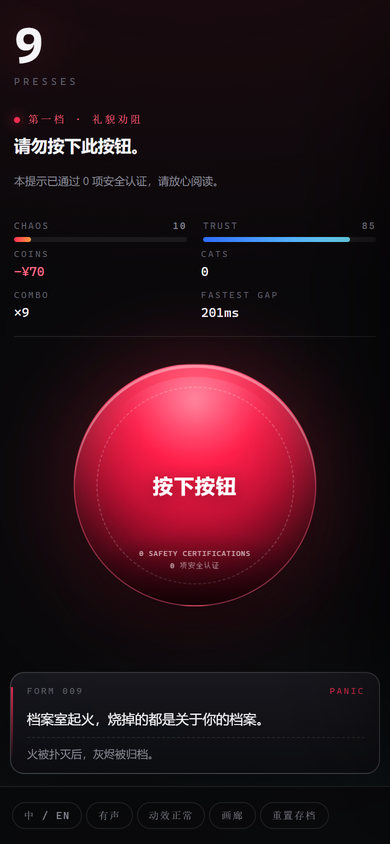

<p align="center">
  
</p>

<h1 align="center">BUTTONCO</h1>

<p align="center">
  <b>The button that is definitely not to be pressed.</b><br>
  You pressed it. Now the world is settling accounts.
</p>

<p align="center">
  <a href="https://github.com/semmelweis-01/buttonco/actions/workflows/ci.yml"></a>
  <a href="./LICENSE"></a>
  
  
</p>

<p align="center">
  <b>English</b> · <a href="./README.zh-CN.md">简体中文</a>
  &nbsp;&nbsp;|&nbsp;&nbsp;
  <a href="https://semmelweis-01.github.io/buttonco/"><b>▶ Play it in your browser</b></a>
</p>

---

## The one-sentence pitch

A button whose only job is to advise you against pressing it. You pressed it. The world begins settling accounts.

## ▶ Play now

**<https://semmelweis-01.github.io/buttonco/>**

No install, no account, no undo. Deployed to GitHub Pages by CI on every push to `main`.

## Screenshots

<p align="center">
  
</p>

<p align="center">
  
</p>

<p align="center">
  
</p>

> All three images are captured from the real build with a headless browser — no mockups. The GIF runs from press 0 to press 50.

## How to play

- **One press, one layer of settlement.** Every click draws an event card and applies its consequences: numbers move, the copy gets more nervous, the interface decays.
- **92 event cards.** Weighted, some one-shot, some on cooldown, some gated behind a predicate — bureaucracy, customer service, cats, tax law, philosophy graduates, the end of the universe.
- **5 escalation tiers** at 0 / 10 / 25 / 50 / 100 presses. Polite, then procedural, then department-wide panic, then cosmic, then out of words.
- **10 endings and 14 achievements.** One ending is secret and is not written down anywhere in this README. Some achievements show as `???` until you earn them.
- **Progress persists across runs.** Endings, achievements and total presses live in `localStorage` behind a corrupt-save guard, so the button remembers what you did long after you close the tab.

## Run it locally

```bash
npm install
npm run dev      # http://localhost:5173
npm test         # vitest: engine, content, i18n, balance and ui suites
```

Build a static bundle (this is exactly what CI deploys):

```bash
npm run build    # tsc --noEmit && vite build  ->  dist/
npm run preview  # serve dist/ locally
```

Requires Node 20+. **Zero runtime dependencies** — everything in `devDependencies` (`typescript`, `vite`, `vitest`, `jsdom`, `@types/node`) is build-and-test tooling and ships nothing to the browser.

## Tech stack & architecture

TypeScript (strict) · Vite 5 · Vitest 2 · zero runtime dependencies · seeded RNG · `localStorage` saves · zh/en copy tables.

```mermaid
flowchart LR
  UI["src/ui + index.html<br/>DOM only — renders state, forwards clicks"]
  ENG["src/engine<br/>pure TypeScript — Engine, press(now), mulberry32 RNG, save"]
  CON["src/content<br/>pure data — 92 events, 5 tiers, 10 endings, 14 achievements"]
  T["src/engine/types.ts<br/>the shared contract"]

  UI -->|press(now), setMuted| ENG
  ENG -->|reads definitions| CON
  ENG -.->|implements| T
  CON -.->|implements| T
```

```
src/
  engine/     pure logic, no DOM, no Math.random, no Date.now
    types.ts  contract shared by engine and content
    engine.ts press pipeline: stats -> tier -> event card -> ending -> achievements
    rng.ts    mulberry32 — same seed, same sequence, same joke
    save.ts   versioned JSON; corrupt saves are discarded, never thrown
    state.ts  state construction and numeric clamping
  content/    data only, zero logic
    events.ts / tiers.ts / endings.ts / achievements.ts
    i18n/     English copy for every card, tier, ending and achievement
  ui/         DOM, audio, animation — the only layer allowed to touch the browser
tests/        engine, content, i18n, balance (40-seed playthrough simulation) and ui suites
```

Three hard rules keep the thing testable: the engine never reads the clock (time arrives as `now`), the engine and content never touch the DOM, and every random draw comes from the injected seeded RNG.

Design notes, the full press pipeline, and how to add content: [docs/DESIGN.md](./docs/DESIGN.md).

## Easter eggs (two of three)

- **Silence.** Turn the sound off, then press 45 times. The world goes quiet. What you did does not.
- **88.** Press exactly 88 times while the company still trusts you. The front desk says the number is auspicious. The front desk is then transferred.
- **The third one.** There is a tenth ending. It is not listed here, it is not a bug, and it is not obvious even if you read the source.

## Safety notice

> **Disclaimer.** This button has passed **0** safety certifications. It has not been approved by any regulator, department, committee, or cat. Side effects may include: unbudgeted bureaucracy, negative account balances, cats (many), a light philosophical crisis, and one (1) secret ending. No real money, no real cats, no real liability — this is a browser game.

## Contributing

Pull requests are welcome, especially new event cards and new endings. Read [CONTRIBUTING.md](./CONTRIBUTING.md) first — it lists the tone rules (cold corporate officialese, no politics, no real company names) and the non-negotiable engineering constraints.

The conceptual spec this project is built against is [SPEC.md](./SPEC.md).

## License

[MIT](./LICENSE) © BUTTONCO Contributors.

<p align="center">
  <a href="./README.zh-CN.md">简体中文版 README</a> ·
  <a href="https://semmelweis-01.github.io/buttonco/">▶ Play</a> ·
  <a href="./docs/DESIGN.md">Design doc</a> ·
  <a href="./CONTRIBUTING.md">Contributing</a>
</p>
